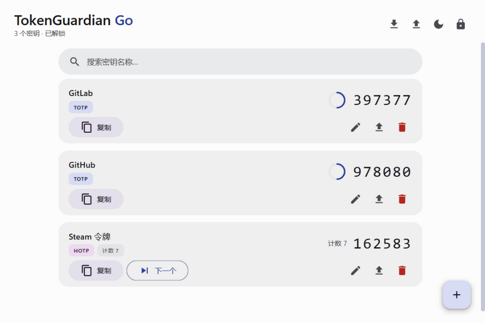
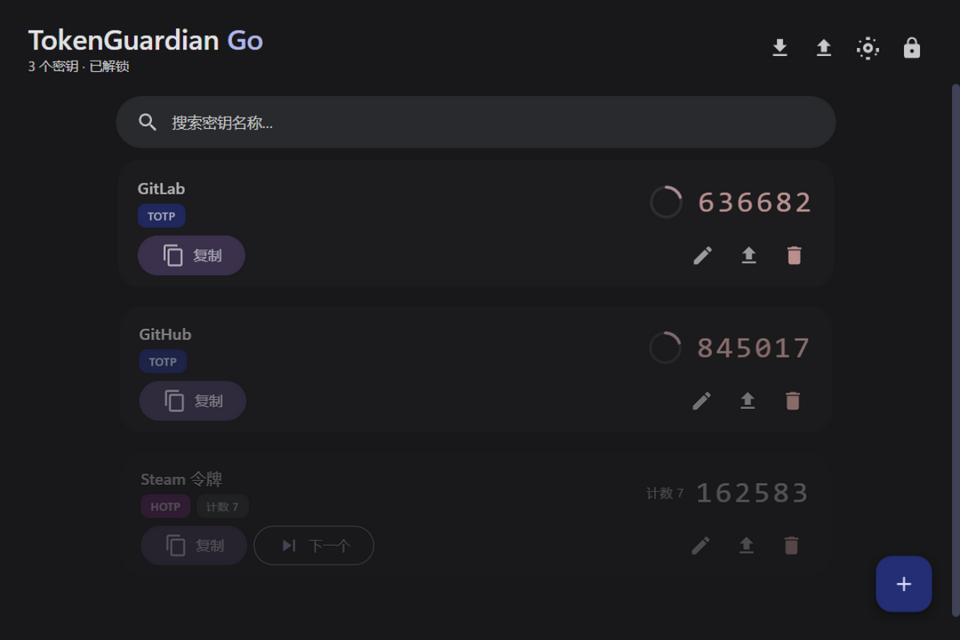
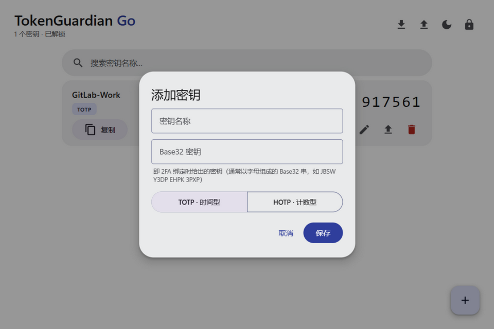

# TokenGuardian Go

<p align="center"></p>

**TokenGuardian Go** 是一个完全离线运行的 2FA（两步验证）验证码生成器，
是 [TokenGuardian（Python 版）](https://github.com/Hellohistory/TokenGuardian) 的 Go 语言重写版。
后端使用 Go + [Wails v2](https://wails.io)，界面遵循 **Material Design 3 Expressive (M3E)** 设计语言。

## 🖼️ 界面预览

| 亮色主题 | 暗色主题 |
|:---:|:---:|
|  |  |

<p align="center"></p>

## ✨ 功能特性

- **双算法支持**：TOTP（RFC 6238，基于时间）与 HOTP（RFC 4226，基于计数器），6 位验证码
- **主密码保险库**：所有密钥经 AES-256-GCM 认证加密后存入本地保险库文件，主密码通过 Argon2id（64MB 内存参数、独立随机盐）派生密钥，抗 GPU 爆破
- **完整密钥管理**：添加 / 编辑 / 删除 / 重命名 / 搜索过滤，TOTP 倒计时环（最后 5 秒变红预警）
- **加密备份**：全部或单条密钥导出为独立密码加密的 `.enc` 文件，可跨设备导入（重名自动跳过）
- **复制即用**：一键复制验证码，按钮带"已复制"变形态反馈
- **便携式存储**：保险库位于程序同目录（系统隐藏文件），删除即重置主密码，拷贝目录即迁移
- **M3E 视觉**：Expressive 弹簧动效、8 级圆角体系、48 色彩角色（明暗双主题，跟随系统可手动切换）
- **原子写入**：保险库每次修改均以临时文件 + rename 原子落盘，防意外断电损坏

## 📥 下载安装

前往 [Releases](../../releases) 页面下载 `TokenGuardianGo.exe`，单文件免安装，双击即用。

> 要求：Windows 10/11（自带 WebView2 运行时）。
>
> ⚠️ 主密码无法找回，请务必牢记！

## 💾 数据存储与密码重置

保险库保存在**程序同目录**下的 `vault.enc`（Windows 系统隐藏文件，资源管理器默认不显示）：

```
你的目录/
├── TokenGuardianGo.exe
└── vault.enc   ← 隐藏属性，存放所有加密后的密钥
```

- **重置主密码**：删除 `vault.enc` 后重新启动程序即可重新设置主密码（原数据不可恢复，重置前请先导出备份）
- **便携使用**：整个目录可直接拷贝到 U 盘 / 其他电脑，数据随程序走
- **显示隐藏文件**：资源管理器 → 查看 → 勾选"隐藏的项目"
- ⚠️ 请勿将程序放在只读目录（如 `C:\Program Files`），否则保险库无法写入

## 🛠️ 从源码构建

```bash
# 安装 Go 1.22+ 与 Wails CLI
go install github.com/wailsapp/wails/v2/cmd/wails@latest

# 开发模式
wails dev

# 构建单文件 exe
wails build
# 产物: build/bin/TokenGuardianGo.exe
```

应用图标由 `tools/genicon` 生成（纯 Go 绘制，4× 超采样）：

```bash
go run ./tools/genicon   # 输出 build/appicon.png 与 build/windows/icon.ico
```

## 🧪 测试

核心算法与加密层附带 RFC 标准测试向量：

```bash
go test ./core/
```

- HOTP：RFC 4226 附录 D 全部 10 个测试向量
- TOTP：RFC 6238 附录 B（SHA1）测试向量
- 保险库：读写 round-trip、错误密码拒绝、密文篡改检测、导出导入

## 🔐 与 Python 版的存储差异

| | Python 版 | Go 版 |
|---|---|---|
| 加密 | AES-256-CBC | AES-256-GCM（认证加密，防篡改） |
| 密钥派生 | PBKDF2-SHA256，硬编码固定盐 | Argon2id，每库独立随机盐 |
| 完整性校验 | 无 | GCM 内建（密码错误/篡改即失败） |
| 写入方式 | 直接覆写 | 临时文件 + rename 原子写 |

## 📄 许可证

[MIT](LICENSE)
